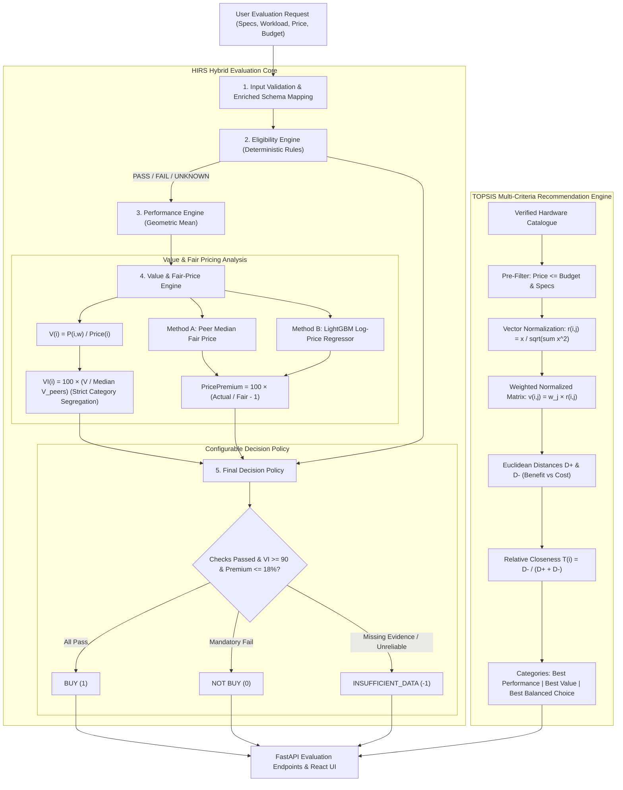

# HIRS Hybrid Hardware Evaluation & Recommendation Engine Architecture

**System Name:** Hardware Intelligence & Recommendation System (HIRS)  
**Architecture Paradigm:** Hybrid Deterministic Verification, Multi-Criteria Geometric Benchmarking, TOPSIS MCDA, and Machine Learning  
**Status:** Production Ready  

---

## 1. High-Level System Architecture

---

## 2. Mathematical Formulations

### 2.1 Workload-Specific Benchmark Scoring
Normalized benchmark ratios:
- Higher-is-better:
  $$R(i,j) = \frac{\text{Benchmark Score}_{i,j}}{\text{Reference Benchmark Score}_j}$$
- Lower-is-better:
  $$R(i,j) = \frac{\text{Reference Completion Time}_j}{\text{Actual Completion Time}_{i,j}}$$

Weighted geometric performance index:
$$P(i,w) = 100 \times \exp\left( \sum_{j} \alpha(w,j) \cdot \ln(R(i,j)) \right)$$
where $\sum_j \alpha(w,j) = 1.0$.

Configured across 6 workloads: Office, Programming, Gaming, Data Analytics, Deep Learning, Video Editing.

### 2.2 Performance-Per-Rupee & Relative Value Index
$$V(i) = \frac{P(i,w)}{\text{Price}(i)}$$
$$VI(i) = 100 \times \left[ \frac{V(i)}{\text{Median}(V_{\text{peers}})} \right]$$
- Strictly segmented by device type (Laptops and Desktops are never combined).
- Peer median queries compare identical product classes and configurations.

### 2.3 Fair-Price Estimation & Price Premium
- **Method A:** Verified comparable peer median price.
- **Method B:** LightGBM Regressor trained on $\ln(\text{PRICE})$ ($R^2$ calibrated, MAPE = 15.81%).
- Price Premium:
  $$\text{PricePremium} = 100 \times \left( \frac{\text{ActualPrice}}{\text{FairPrice}} - 1 \right)$$

### 2.4 TOPSIS Recommendation Ranking
- **Vector Normalization:**
  $$r(i,j) = \frac{x(i,j)}{\sqrt{\sum_k x(k,j)^2}}$$
- **Ideal Solutions:**
  $$\text{ideal}(j) = \max_i v(i,j) \quad \text{for benefits}, \quad \min_i v(i,j) \quad \text{for cost (Price)}$$
  $$\text{negativeIdeal}(j) = \min_i v(i,j) \quad \text{for benefits}, \quad \max_i v(i,j) \quad \text{for cost (Price)}$$
- **Relative Closeness:**
  $$T(i) = \frac{D^-(i)}{D^+(i) + D^-(i)}$$
  Candidates pre-filtered by budget and ranked by descending $T(i)$.
